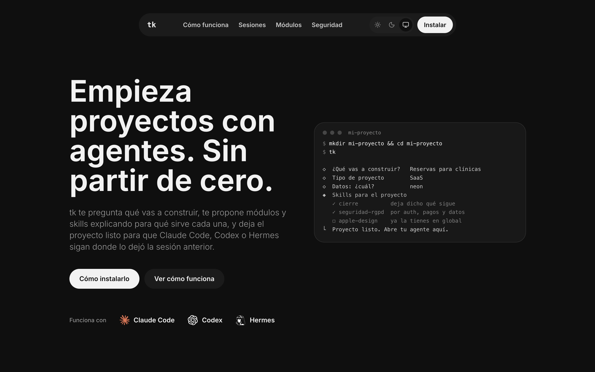

# toolkit

Un comando para empezar un proyecto con agentes de IA (Claude Code, Codex, Hermes): te
pregunta qué vas a construir, propone módulos y skills explicando para qué sirve cada una,
y deja el proyecto con un flujo de sesión (arranque y cierre) que cualquier agente sigue.

**Estado:** primera versión (0.1). Puede cambiar entre versiones menores.

<picture>
  <source media="(prefers-color-scheme: dark)" srcset="https://raw.githubusercontent.com/manuelt15/toolkit-public/main/docs/img/landing-oscuro.png">
  
</picture>

## Instalar

Requisitos: Node 22 o superior, macOS o Linux (en Windows, WSL).

```bash
npm install -g @manuelt15/toolkit
```

El comando se llama `tk`. Sin `postinstall`, sin telemetría: solo usa la red cuando ejecuta,
con tu permiso, el comando de instalación de una skill de terceros.

## Uso

```bash
mkdir mi-proyecto && cd mi-proyecto
tk
```

El asistente pregunta, en este orden: qué vas a construir, el tipo de proyecto (SaaS,
landing, agente IA, API, herramienta), los módulos (con lo que te dan y lo que te cuestan),
las skills (las recomendadas marcadas, y te avisa de las que ya tienes en global), tu sistema
de diseño si hay interfaz, y la identidad de git solo si no se puede deducir.

Sin teclado (CI, scripts, otro agente):

```bash
tk --preset saas --option datos=neon --description "Reservas para clínicas" --design reference --yes
tk --preset landing --dry-run        # enseña lo que haría, sin escribir nada
```

| Comando | Para qué |
|---|---|
| `tk` / `tk new` | Monta el proyecto |
| `tk start` | Brief al empezar la sesión: pendientes, última lección, git |
| `tk close` | Cierre: handover con huecos para el agente, índice, poda de pendientes y checklist |
| `tk close --commit` | Commit de `memory/` (nunca push), solo si no quedan huecos sin rellenar |
| `tk skills` | Catálogo con el estado de cada skill; `tk skills add <id>` añade una |
| `tk doctor` | Comprueba el proyecto contra `toolkit.lock.json`; `--fix` repara lo local |

## Qué deja en el proyecto

- `AGENTS.md` con el flujo de sesión y las skills (`CLAUDE.md` apunta a él).
- `DESIGN.md` si hay interfaz: toda la UI sale de ahí, nunca del tema por defecto.
- `memory/`: índice, pendientes, lecciones y handovers de cada sesión.
- `.agents/skills/` con las skills del proyecto, enlazadas para Claude (`.claude/skills`) y
  Hermes (`.hermes/skills`), y el hook de Claude que lanza `tk start`.
- `docs/toolkit/modulos/` con la guía de cada módulo elegido.
- `toolkit.lock.json`: lo instalado, para que `doctor` y `skills` sepan qué hay.

En Codex y Hermes el brief llega porque `AGENTS.md` pide `tk start` al empezar.

## Perfil propio (opcional)

Si tienes reglas o identidades que quieres en todos tus proyectos, crea
`~/.config/tk/profile.json` (o pásalo con `--profile`):

```json
{
  "nombre": "tu-usuario",
  "agents_md": "AGENTS.md",
  "identidades": [
    { "cuenta": "personal", "github": "tu-usuario", "email": "tu@correo" },
    { "cuenta": "trabajo", "github": "tu-usuario-trabajo", "detectar": "global" }
  ]
}
```

`agents_md` es un fichero junto al perfil con tus reglas: se añade a cada `AGENTS.md` en su
propio bloque. Con identidades, `--git personal` o `--git trabajo`. Los emails nunca se
escriben en el proyecto.

## Condiciones

- Se ofrece tal cual (as-is), sin soporte ni plazos. No se aceptan PRs de módulos.
- Las skills de terceros no se incluyen: se instalan desde su origen, con su licencia, y
  siempre enseñando el comando antes.
- Una versión publicada en npm no se puede reemplazar. Si alguna vez se filtrara un secreto,
  se rota; borrar el paquete no lo arregla.

## Licencia

MIT
